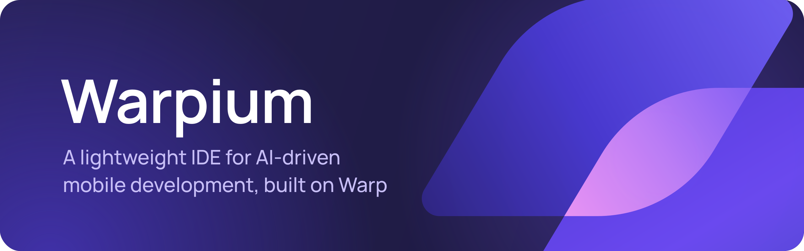
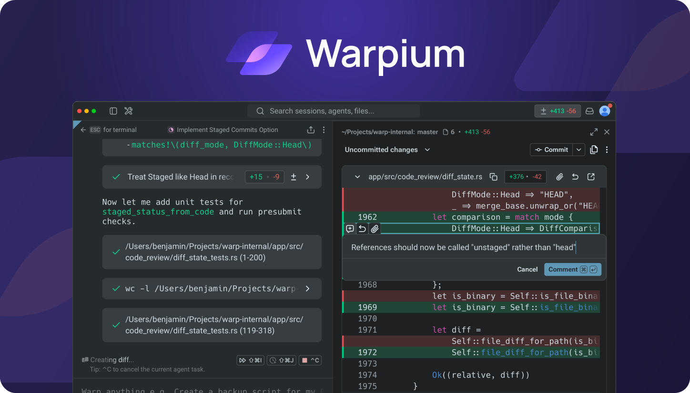
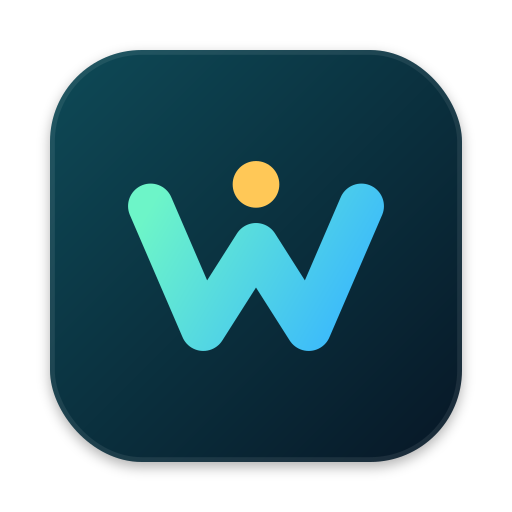

<p align="center">
  
</p>

<p align="center">
  <b>A lightweight IDE for AI-driven mobile development, built on Warp.</b><br />
  <sub>Легковесная IDE для AI-мобильной разработки на базе Warp</sub>
</p>

<p align="center">
  <a href="https://github.com/MILKA-TOP/warpium/actions/workflows/warpium-build.yml"></a>
  <a href="https://github.com/MILKA-TOP/warpium/releases"></a>
  <a href="LICENSE-AGPL"></a>
</p>

<p align="center">
  
</p>

## About

Warpium is a lightweight IDE for AI-driven mobile development, built on [Warp](https://github.com/warpdotdev/warp), the open-source agentic development environment born out of the terminal. It is Warp's open-source build under its own name and icon, with features for Android/Kotlin development with AI agents added on top. All credit for Warp goes to its original authors.

> [!NOTE]
> Warpium is an unofficial, personal project. It is not affiliated with, endorsed by, or supported by Warp (Denver Technologies, Inc). Please do not report Warpium issues to the Warp team.

## Install (macOS, Apple silicon)



1. **Download** `Warpium-…-arm64.dmg` from the [latest release](https://github.com/MILKA-TOP/warpium/releases/latest). The release notes list what changed and the file's SHA-256 checksum. For a development build of the newest `master`, open [Actions](https://github.com/MILKA-TOP/warpium/actions/workflows/warpium-build.yml), pick the latest successful run and download its artifact: a `.zip` that contains the `.dmg`. Downloading from Actions needs a GitHub sign-in, and artifacts expire after 30 days.
2. **Open the `.dmg`** and drag **Warpium** to **Applications**.
3. **Allow it to launch.** Warpium is not notarized by Apple, so macOS blocks it at first. Either run this in Terminal:

   ```bash
   xattr -dr com.apple.quarantine /Applications/Warpium.app
   ```

   or right-click Warpium in Applications and choose **Open**. On recent macOS versions, try to open it once, then go to **System Settings → Privacy & Security** and click **Open Anyway**.
4. **Launch Warpium** from Applications or Spotlight. On first launch, sign in or skip, then open a folder or a terminal tab.

**Good to know**

- Only Apple silicon (arm64) Macs are supported for now.
- Warpium doesn't update itself. To update, download the new release and replace the app in Applications; your settings are kept.
- Downloaded builds don't include the built-in `modify-settings` agent skill yet; builds from source do.
- Warpium can be installed next to the official Warp app; their app data and preferences are separate.
- It shares `~/.warp-oss` (settings, themes, skills) with upstream Warp's open-source build.
- Don't install it next to an upstream `WarpOss.app`: both handle `warposs://` links, so sign-in may open the wrong app.

## Build from source

You need macOS with Xcode 26, Homebrew and `rustup`.

```bash
./script/bootstrap   # install the toolchain and dependencies
./script/run         # build and run a debug Warpium.app
```

To build a release `.dmg` like the published ones, see the [developer guide](WARPIUM.md#local-release-build).

## Planned features

- **Open in new tab, fixed.** "Open in new tab" in the file tree opens the folder you selected instead of your home folder.
- **Smarter search.** Project search can respect `.gitignore` and take include and exclude filters such as `*build*`.
- **Git log.** A JetBrains-style git log and graph with branches, commits and sorting.
- **Upstream updates.** A notification when a new Warp version is available, so it can be merged into Warpium.
- **Images for agents in Docker.** Paste images into CLI agents such as Claude Code that run inside Docker containers.
- **Kotlin and code navigation.** Kotlin support and IDE-like navigation, as if the project were indexed. The goal is to replace Android Studio for everyday work.
- **Run configurations.** Build and run Android Studio and IntelliJ IDEA projects from their run configurations, and possibly show Compose Preview. This is still being researched, with a focus on performance.

## License and trademarks

Warpium keeps Warp's licensing: the UI framework crates (`warpui_core` and `warpui`) are under the [MIT license](LICENSE-MIT), and the rest of the code is under the [GNU AGPL v3](LICENSE-AGPL). The complete source of every Warpium build is in this repository.

"Warp" and the Warp logo are trademarks of their respective owner. Warpium uses the name only to say where it comes from. It is not an official Warp product and is not affiliated with Warp, and its logo is not derived from Warp's.
