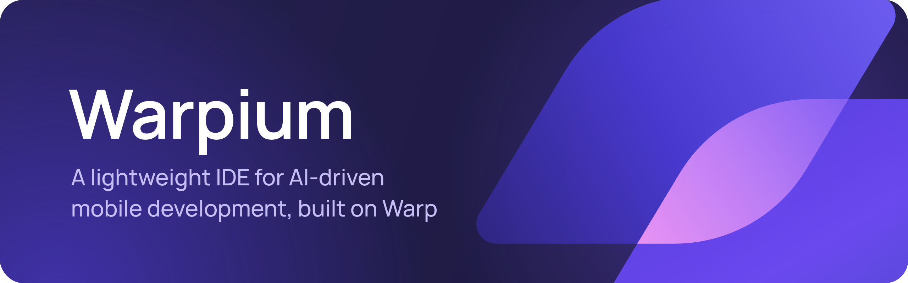
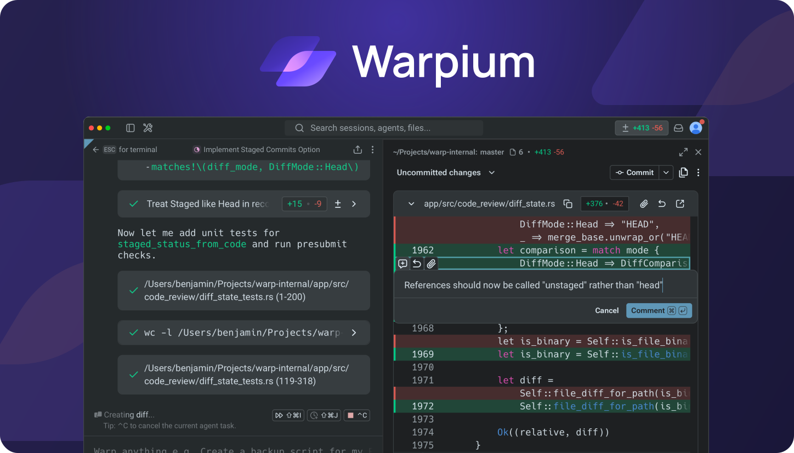
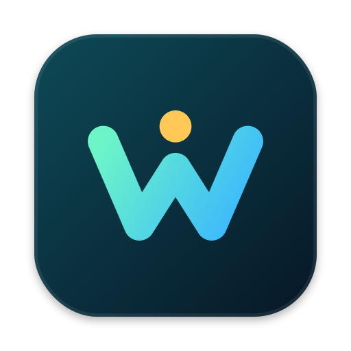

<p align="center">
  
</p>

<p align="center">
  <b>A lightweight IDE for AI-driven mobile development, built on Warp.</b><br />
  <sub>Легковесная IDE для AI-мобильной разработки на базе Warp</sub>
</p>

<p align="center">
  <a href="https://github.com/MILKA-TOP/warpium/actions/workflows/warpium-build.yml"></a>
  <a href="https://github.com/MILKA-TOP/warpium/releases"></a>
  <a href="LICENSE-AGPL"></a>
</p>

<p align="center">
  
</p>

## About

Warpium is a lightweight IDE for AI-driven mobile development, built on [Warp](https://github.com/warpdotdev/warp), the open-source agentic development environment born out of the terminal. It is Warp's open-source build under its own name and icon, with features for Android/Kotlin development with AI agents added on top. All credit for Warp goes to its original authors.

> [!NOTE]
> Warpium is an unofficial, personal project. It is not affiliated with, endorsed by, or supported by Warp (Denver Technologies, Inc). Please do not report Warpium issues to the Warp team.

## Install (macOS, Apple silicon)



1. **Download** `Warpium-…-arm64.dmg` from the [latest release](https://github.com/MILKA-TOP/warpium/releases/latest). The release notes list what changed and the file's SHA-256 checksum. For a development build of the newest `master`, open [Actions](https://github.com/MILKA-TOP/warpium/actions/workflows/warpium-build.yml), pick the latest successful run and download its artifact: a `.zip` that contains the `.dmg`. Downloading from Actions needs a GitHub sign-in, and artifacts expire after 30 days.
2. **Open the `.dmg`** and drag **Warpium** to **Applications**.
3. **Allow it to launch.** Warpium is not notarized by Apple, so macOS blocks it at first. Either run this in Terminal:

   ```bash
   xattr -dr com.apple.quarantine /Applications/Warpium.app
   ```

   or right-click Warpium in Applications and choose **Open**. On recent macOS versions, try to open it once, then go to **System Settings → Privacy & Security** and click **Open Anyway**.
4. **Launch Warpium** from Applications or Spotlight. On first launch, sign in or skip, then open a folder or a terminal tab.

**Good to know**

- Only Apple silicon (arm64) Macs are supported for now.
- A tab's Project Explorer can be locked to a project: use the pin button in the explorer header, **Open Folder as Project…** (`⌘⌥⇧O`) or **Open in new tab** on a folder. A locked explorer stays on the project wherever the tab's terminals go (another folder, a Docker container, SSH), and tells you when the terminal is outside it. Unlock to follow the terminals again.
- New Warpium releases are offered in the app: a banner shows **Update now**, which downloads the release from GitHub and checks it in the background, then **Restart now** switches to it; otherwise it is installed when you quit (Warpium never restarts on its own). Apple silicon only. You can also run **Check for Warpium updates** from the command palette, or turn the checks off with `warpium.update_check = false` in `settings.toml`. Official Warp updates are never offered. Your settings are kept.
- If Warpium can't replace itself (for example when it isn't in a folder you can write to), the banner offers the downloaded `.dmg` to install by hand.
- Downloaded builds don't include the built-in `modify-settings` agent skill yet; builds from source do.
- Warpium can be installed next to the official Warp app; their app data and preferences are separate.
- It shares `~/.warp-oss` (settings, themes, skills) with upstream Warp's open-source build.
- Don't install it next to an upstream `WarpOss.app`: both handle `warposs://` links, so sign-in may open the wrong app.

## Build from source

You need macOS with Xcode 26, Homebrew and `rustup`.

```bash
./script/bootstrap   # install the toolchain and dependencies
./script/run         # build and run a debug Warpium.app
```

To build a release `.dmg` like the published ones, see the [developer guide](WARPIUM.md#local-release-build).

## Project toolbar

Buttons for your project's everyday commands sit in the top-right corner of the window, like the toolbar in JetBrains IDEs, next to a run-configurations dropdown and a **Run** button. When the window gets narrow, the buttons that don't fit move into a **…** menu.

- Click **+** at the end of the toolbar (or **+ Add button** in a project that has none), choose **Customize toolbar…** in the **…** menu, run **Customize project toolbar** from the command palette, or right-click a button to edit it. The editor adds, reorders, hides and deletes buttons, runs any shell command (in the current session, a new tab or a split, with a working directory and environment variables), a workflow, a launch configuration, a tab config, a URL or a built-in action, and saves each button either for the whole project or just for you. **Test run** tries a command before you save.
- Commands can use `${projectRoot}`, `${file}`, `${fileDir}`, `${selection}`, `${cwd}` and `${prompt:Label}` (asks you for a value when the button runs). Warpium quotes each value for your shell, so write them without quotes.
- Run **Edit project toolbar** from the command palette to create `.warpium/toolbar.toml` in the project; commit it to share the buttons with your team. The file starts with commented examples.
- Run **Edit personal toolbar overrides** to add, change or hide buttons just for yourself. These are kept in `~/.warp-oss/projects/`, never in the project.
- A button can run a command in the current tab, a new tab or a split, run a saved workflow, open a launch configuration or tab config, open a link, or trigger a Warpium action such as opening the Project Explorer.
- Commands from a committed `toolbar.toml` only run after you confirm that you trust it. Warpium lists them first, and asks again whenever the file changes. Your personal buttons never ask.
- Turn the toolbar off in **Settings → Features → Warpium**, from the command palette, or with `warpium.project_toolbar = false` in `settings.toml`.

## Android: run on a device, and Logcat

In an Android project, the project toolbar shows a **device picker** next to the run configurations, with one run configuration per app module. Pick a connected phone (USB or Wi-Fi) or an emulator, then click **Run**: Warpium runs `./gradlew :app:installDebug` in your terminal, where you can watch the build, then starts the app on the device as soon as it is installed and opens Logcat for it.

- Picking an emulator that isn't running starts it in its own window and selects it once it has booted. Clicking **Run** while it is still booting runs the app as soon as it is ready.
- The first run in a project asks you to trust its Gradle build, since it runs the project's `gradlew` and build scripts.
- Runs use the `debug` build variant. For other variants or flavors, add a toolbar button with your own Gradle command for now.

Run **Open Logcat** from the command palette to open a live log of your Android device or emulator in a pane, like Logcat in Android Studio. It works with emulators and with phones connected over USB or Wi-Fi.

- The device menu at the top left of the pane lists the connected devices and your emulators (AVDs). Pick an emulator that isn't running to start it in its own window; Logcat switches to it once it has booted. **Select Android device** and **Launch Android Virtual Device (AVD)** in the command palette open the same menu.
- Filter by app package (filled in with your project's app, and it keeps following the app when it crashes and restarts), minimum level, tags (`MyTag, -Noisy` hides `Noisy`) and text or a regular expression.
- Click a stack-trace line such as `at com.example.MainViewModel.load(MainViewModel.kt:42)` to open that file at that line.
- Pause the log to read it without new lines arriving, clear it, or click a line and press ⌘C to copy it. **Copy shown log** in the pane's menu copies everything that passes the filters.
- Warpium finds the Android SDK the way Gradle does (`local.properties`, `ANDROID_HOME`, then `~/Library/Android/sdk`) and talks to the adb server directly. adb is only contacted in Android projects, or once you open Logcat.
- Turn the Android tools off from the command palette, or with `warpium.android = false` in `settings.toml`.

### Let your AI agent read the logs

Coding agents can read your app's Logcat and crashes too, so they can check their own fixes: run **Install MCP servers for AI agents** from the command palette (or click **Install** in Settings → Features → Warpium). Warpium adds its Logcat and Kotlin/Java code index servers to Claude Code, Codex and Kimi Code on your Mac, in your personal (not committed) settings, or to `.arc/private/` if the project uses arc. Agents can then list devices, read recent logs of your app, get crashes with their stack traces pointing at your files, and wait for a log line after restarting the app. Logs stay in memory and are limited to your app unless the agent explicitly asks for everything. For Warp's own agent, turn on **Logcat MCP server for Warp's agent** in the same place. **Uninstall MCP servers for AI agents** removes them again.

## Planned features

- **Git log.** A JetBrains-style git log and graph with branches, commits and sorting.
- **Upstream updates.** A notification when a new Warp version is available, so it can be merged into Warpium.
- **Images for agents in Docker.** Paste images into CLI agents such as Claude Code that run inside Docker containers.
- **Kotlin and code navigation.** Kotlin support and IDE-like navigation, as if the project were indexed. The goal is to replace Android Studio for everyday work. Already there: in a Kotlin or Java project, ⌘O searches classes, symbols and files in **All / Classes / Symbols / Files** tabs, like Search Everywhere in Android Studio (Tab switches tabs).
- **Run configurations.** Build and run Android Studio and IntelliJ IDEA projects from their run configurations, and possibly show Compose Preview. This is still being researched, with a focus on performance.

## License and trademarks

Warpium keeps Warp's licensing: the UI framework crates (`warpui_core` and `warpui`) are under the [MIT license](LICENSE-MIT), and the rest of the code is under the [GNU AGPL v3](LICENSE-AGPL). The complete source of every Warpium build is in this repository.

"Warp" and the Warp logo are trademarks of their respective owner. Warpium uses the name only to say where it comes from. It is not an official Warp product and is not affiliated with Warp, and its logo is not derived from Warp's.
